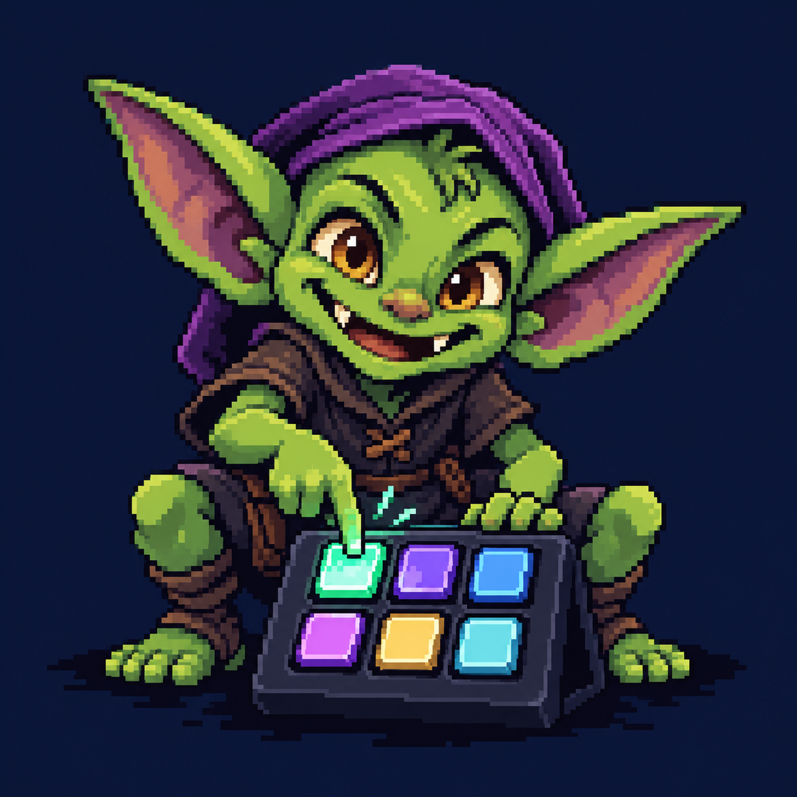

# Button Goblin



**MiSTer × Stream Deck**

**Animated console launchers. MiSTer shortcuts. One deck—or two.**

Turn an **Elgato Stream Deck MK.2** or **six-key Stream Deck Mini** into a dedicated MiSTer control panel. Launch cores and favorite games, navigate menus, adjust brightness, and run Update All from animated buttons. The launcher runs directly on MiSTer over USB.

[](https://github.com/pxpxpxp/buttongoblin/actions/workflows/mini-release.yml)

[15-key animated guide](https://buttongoblin.monster/) · [Mini animated guide](https://buttongoblin.monster/mini.html) · [MK.2 Deck Editor](https://buttongoblin.monster/editor/) · [Mini Editor](https://buttongoblin.monster/editor/mini.html) · [All releases](https://github.com/pxpxpxp/buttongoblin/releases)

## Choose your setup

| Your setup | Download | Run after copying |
| --- | --- | --- |
| **Mini + 15-key MK.2 together** | **[Dual v2.0.0 ZIP](https://github.com/pxpxpxp/buttongoblin/releases/download/dual-v2.0.0/ButtonGoblin_Dual_v2_0_0.zip)** | `ButtonGoblin_Both_Enable.sh` |
| Six-key Mini | [Mini v2.0.0 ZIP](https://github.com/pxpxpxp/buttongoblin/releases/download/mini-v2.0.0/ButtonGoblin_Mini_v2_0_0.zip) | `ButtonGoblin_Mini_Enable.sh` |
| 15-key MK.2 | [Current MK.2 in Dual v2.0.0](https://github.com/pxpxpxp/buttongoblin/releases/download/dual-v2.0.0/ButtonGoblin_Dual_v2_0_0.zip) | `ButtonGoblin_Enable.sh` |

The Dual bundle also works with only the MK.2 enabled.

**Using both decks? Choose the Dual bundle.** It includes both binaries, independent configurations and service controls, and a shared lock to prevent duplicate Update All jobs from the two launchers.

## What’s on the deck

- **Animated character artwork** for consoles and utilities, plus a startup mosaic that fades in and out.
- **Game and core launchers**, including a Donkey Kong Country favorite on SNES and the MegaDrive core for Genesis.
- **Animated navigation shortcuts** that keep their own artwork and turn green while held.
- **Stay Puft touches:** brightness control and a Back animation that morphs every fifth cycle.
- **Update All feedback:** running animation, failure feedback, and a finished state with a periodic green pulse.
- **Five brightness levels:** 10%, 25%, 50%, 75%, and 100%.

## Install

1. Download and extract the ZIP for your setup.
2. Copy the package’s complete **Scripts contents** into `/media/fat/Scripts/`, including hidden **.config**.
3. Connect your Elgato Stream Deck Mini, MK.2, or both to MiSTer’s USB host hub.
4. Run **ButtonGoblin_Mini_Enable.sh** for Mini, **ButtonGoblin_Enable.sh** for MK.2, or **ButtonGoblin_Both_Enable.sh** for both. The selected services start immediately and at boot.

Cores, games, BIOS files, favorites and Update All are separate installs. The Update All button expects `/media/fat/Scripts/update_all.sh`.

To show hidden files in macOS Finder, press **Command–Shift–period**. In Windows Explorer, enable **View → Show → Hidden items**.

## Run both decks together

The Dual bundle keeps both decks active on the same MiSTer. Each has its own pages, artwork, brightness, boot entry, process locks, and logs. A core launch or keyboard shortcut from either deck controls the current MiSTer session.

| Device | Configuration folder | Enable / disable scripts |
| --- | --- | --- |
| 15-key MK.2 | `Scripts/.config/buttongoblin/` | `ButtonGoblin_Enable.sh` / `ButtonGoblin_Disable.sh` |
| Six-key Mini | `Scripts/.config/buttongoblin-mini/` | `ButtonGoblin_Mini_Enable.sh` / `ButtonGoblin_Mini_Disable.sh` |
| Both | Both folders above | `ButtonGoblin_Both_Enable.sh` / `ButtonGoblin_Both_Disable.sh` |

Either service can be stopped or reloaded independently. Each launcher selects its supported USB device family. If Update All is already running through one of the included launchers, a second request is rejected and logged; retry when it finishes. This coordination does not cover updater jobs started manually.

**[Complete dual-deck setup and service details →](mini/DUAL_README.md)**

## 15-key MK.2 layout

Buttons are numbered left to right across each row, starting at **1**.

### Page one · Consoles

| 1 · NES | 2 · SNES | 3 · Genesis | 4 · TurboGrafx-16 | 5 · PlayStation |
| :---: | :---: | :---: | :---: | :---: |
| **6 · Saturn** | **7 · Nintendo 64** | **8 · Mega CD** | **9 · Game Boy Advance** | **10 · Game Boy** |
| **11 · Master System** | **12 · Neo Geo** | **13 · The Simpsons** | **14 · Update All** | **15 · Brightness / Shortcuts** |

**Tap button 15** to cycle brightness upward. **Hold it for one second** to open page two, then release before using the shortcuts.

### Page two · Navigation

| 1 · Menu / F12 | 2 · — | 3 · ↑ Up | 4 · — | 5 · Escape |
| :---: | :---: | :---: | :---: | :---: |
| **6 · —** | **7 · ← Left** | **8 · ↓ Down** | **9 · → Right** | **10 · Enter** |
| **11 · Space** | **12 · —** | **13 · —** | **14 · —** | **15 · Back** |

Menu opens MiSTer’s menu; arrows navigate; Enter selects; Escape backs out. During controller mapping, use **Space** to skip an entry and **Enter** to finish. Press and release **Back** to return to the console page.

## Six-key Mini layout

### Home · Page one

| 1 · NES | 2 · SNES | 3 · Genesis |
| :---: | :---: | :---: |
| **4 · Update All** | **5 · Brightness** | **6 · Next** |

**Update All is on the first page, bottom left.** Tap button 5 for brightness, or hold it for one second to jump to Navigation. Button 6 cycles through all six pages on release.

| Page | Top row · 1 / 2 / 3 | Bottom row · 4 / 5 / 6 |
| --- | --- | --- |
| 2 · Consoles | TurboGrafx-16 / PlayStation / Saturn | Nintendo 64 / Mega CD / Next |
| 3 · Consoles | Game Boy Advance / Game Boy / Master System | Neo Geo / The Simpsons / Next |
| 4 · Navigation | Up / Left / Down | Right / Enter / Next |
| 5 · Shortcuts | Menu / Escape / Space | Back to Home / Brightness / Next |
| 6 · Y / N | Y / N / — | Back to Home / — / Next |

Release held buttons before using a new page. Update All feedback remains associated with Home while you browse other pages.

**[Mini configuration, installation, and diagnostics →](mini/README.md)**

## Make it yours

**MK.2:** use the [Deck Editor](https://buttongoblin.monster/editor/) on your computer. Assign actions, paths, and artwork; save an editable project; then export for MiSTer. Disable the MK.2 service before copying the export and enable it afterward. The standalone MK.2 ZIP also includes an offline editor.

**Mini:** use the [Mini Editor](https://buttongoblin.monster/editor/mini.html) to edit all six pages, assign actions and animated artwork, and export Mini-ready BMP animations. Update All stays on Home button 4; button 6 advances through the pages. Save a Mini project JSON to keep your edits. Wait for Update All to finish, disable Mini, copy the export’s complete `Scripts` contents (including hidden `.config`) into `/media/fat/Scripts/`, then enable Mini. The export contains configurations and artwork; install the Mini launcher separately.

Configuration indices start at zero: `key.0` means physical button 1. Labels are metadata; visible lettering is part of the artwork.

Check your installed paths before launching games. The default SNES favorite is:

```text
/media/fat/_@Favorites/Donkey Kong Country (USA) (Rev 2).mgl
```

GIFs are converted into prepared animation frames before playback. The MK.2 uses JPEG frames in `.sda` files; the Mini uses BMP frames in `.sma` files. MiSTer plays the cached frames without decoding GIFs. Keep each device’s configuration and artwork together.

## Help and diagnostics

| Symptom | Check |
| --- | --- |
| Deck stays on its built-in logo | USB host connection, data cable/adapter, matching package, and enabled service. |
| Wrong or stale artwork | Copy the complete matching configuration and icons set, then disable and enable that service. |
| Shortcut buttons do nothing | Check diagnostics for virtual-keyboard errors. |
| Game or core does not launch | Verify the installed `.rbf`, favorite `.mgl`, or arcade `.mra` path. |
| Update All fails | Confirm Bash and `Scripts/update_all.sh` are installed; inspect the script log. |
| Other USB devices disconnect or become sluggish | Inspect the Mini diagnostics report for hub topology, power descriptors, kernel messages, and transfer counters. |

For SSH diagnostics:

```sh
# 15-key MK.2
sh /media/fat/Scripts/.config/buttongoblin/extras/ButtonGoblin_Diagnostics.sh

# Six-key Mini
sh /media/fat/Scripts/.config/buttongoblin-mini/extras/ButtonGoblin_Mini_Diagnostics.sh
```

MK.2 runtime files use `/tmp/buttongoblin.*`; Mini files use `/tmp/buttongoblin_mini.*`. Each service handles worker recovery and USB reconnection. Invalid configuration reloads retain the prior working set.

## Build and verification

GitHub Actions restores integrity-checked source artwork and scripts, prepares the device-specific packages, runs host tests, and builds **static Cortex-A9 ARM binaries** with **Zig 0.13.0**. Releases include ZIPs and SHA-256 checksums.

- **[MK.2 checks](.github/workflows/mini-release.yml):** configuration, input handling, page switching, animation loading, failure handling, and memory checks.
- **[Mini and Dual workflow](.github/workflows/mini-release.yml):** Mini protocol and sanitizer checks, MK.2 regression tests, simultaneous host services, independent shutdown and boot entries, and Update All exclusion in both directions.

Current native runtimes are [`mk2/buttongoblin-mk2.c`](mk2/buttongoblin-mk2.c) and [`mini/buttongoblin-mini.c`](mini/buttongoblin-mini.c). The Dual build copies these sources directly, without patching C code during packaging. Build preparation lives in [`tools/`](tools/) and [`mini/`](mini/); package versions and names are defined in [`mini/releases.py`](mini/releases.py). Each package includes the resulting native source and a `source/build.sh` script. Rebuild on a computer with Zig installed by running that script from the appropriate device’s installation folder.

**Hardware validation:** host tests and ARM compilation do not verify physical image orientation, USB timing, hub power, controller responsiveness, or a complete updater run. Check those on your MiSTer, particularly with both decks attached.

## Credits

Each release includes **LICENSE.txt** and **ARTWORK_CREDITS.txt** with the project’s licensing and artwork attribution. Third-party notices are retained; characters, console logos, and trademarks belong to their respective owners.

---

**[Download Dual](https://github.com/pxpxpxp/buttongoblin/releases/tag/dual-v2.0.0)** · **[Mini guide](https://buttongoblin.monster/mini.html)** · **[15-key guide](https://buttongoblin.monster/)** · **[MK.2 editor](https://buttongoblin.monster/editor/)**
